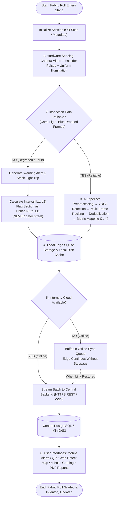
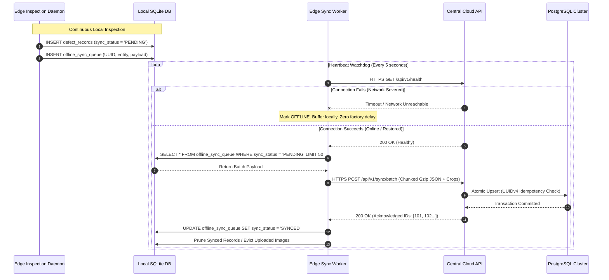

# TexEye AI — System Workflow Specification

## 1. Overview

The operational workflow of **TexEye AI** follows the physical journey of a fabric roll: from the moment it is loaded onto the inspection stand, through high-speed sensor capture, real-time quality verification, AI defect detection, physical location mapping, local edge saving, and eventual cloud synchronization.

This document breaks down the three main workflows in the system:
1. **End-to-End Main System Workflow**
2. **AI Vision & Coordinate Mapping Pipeline**
3. **Offline / Online Data Synchronization Workflow**

---

## 2. Main System Workflow



### 2.1 Step-by-Step Main System Workflow Execution

1. **Roll Loading & Session Start:**
   - The fabric roll is mounted onto the unwinding/inspection frame.
   - The Floor Operator opens the TexEye AI mobile app and scans the QR code sticker on the roll's core tube.
   - The edge computer creates a new `inspection_session` record in its local SQLite database, recording the roll ID, fabric type (e.g., cotton plain weave, denim, twill), nominal width ($W_{cm}$), and start time.

2. **Continuous Sensing & Controlled Lighting:**
   - As fabric starts moving, the LED light bar illuminates the inspection zone evenly, minimizing shadows from the fabric's weave texture.
   - The industrial camera captures frames at high speed (30–60+ FPS depending on line speed) and pushes them into an in-memory ring buffer.
   - At the same time, the rotary encoder (coupled to a friction roller resting against the fabric) sends electrical pulse signals to track exact movement down to the millimeter.

3. **Real-Time Reliability Check (The "Gate"):**
   - Before any frame is sent to the AI model, it must pass four quick health checks:
     - **Camera Connection:** Is the video feed active with zero connection drops?
     - **Lighting Level:** Is the average brightness within normal range ($[L_{min}, L_{max}]$), or did a light fail?
     - **Image Focus / Blur:** Using Laplacian variance ($\sigma^2_{Lap}$), does the image look sharp, or is the lens dirty/blurry?
     - **Dropped Frames:** Does the number of captured frames match the distance measured by the encoder?

4. **The Critical Fork: Reliable vs. Unreliable Data:**
   - **Path A — Everything Looks Good (Reliable):**
     - The frame is passed directly to the AI detection model.
     - The model finds defects, draws bounding boxes, and predicts defect types.
     - The tracking module follows defects across consecutive frames so they aren't counted twice.
     - The coordinate engine calculates the exact location: $X$ across the width (cm) and $Y$ along the length (m).
   - **Path B — Something Failed (Unreliable):**
     - The system immediately triggers a warning alert (local light beacon turns amber/red and the operator's phone buzzes).
     - The system notes the encoder count where the problem started ($L_1$) and where it ended ($L_2$).
     - The section $[L_1, L_2]$ is saved as **`UNINSPECTED`**.
     - **Core Rule:** This section is *never* marked as clean or defect-free. It stays flagged until a human inspects it.

5. **Saving Locally on the Edge:**
   - Both defect records and uninspected sections are written immediately to the local SQLite database and local NVMe storage.
   - Writing locally takes under 5 milliseconds, so the inspection line never has to wait for a database or network.

6. **Cloud Sync (Online vs. Offline):**
   - **If the network is up:** The edge computer sends batches of records and defect images to the central backend using HTTPS REST and WebSockets.
   - **If the network is down:** The edge computer puts the records into a local `offline_sync_queue` table. Inspection keeps running at full speed. A background worker periodically checks for connectivity and syncs everything automatically as soon as the network comes back.

7. **Applications & User Actions:**
   - **Mobile App:** Floor operators see real-time alerts, review defect pictures, and can fix misclassified labels on the spot.
   - **Web Dashboard:** Quality managers open the 2D Digital Defect Map, verify defect counts, approve the standardized 4-Point grade, and download the official PDF inspection certificate.

---

## 3. Detailed AI Vision & Metrology Workflow

The AI processing pipeline takes raw camera frames and encoder pulses and turns them into clean, deduplicated defect records with physical real-world coordinates.

```mermaid
flowchart TD
    A([Video Frame + Rotary Encoder Pulses]) --> B[1. ROI Cropping & Geometric Undistortion]
    B --> C[2. Contrast Normalization - CLAHE]
    C --> D[3. AI Defect Detector - YOLO Backbone]
    D --> E{Defect Score &ge; &theta;?}
    E -- No --> F[Log Clean Frame Span]
    E -- Yes --> G[4. Multi-Frame Tracker - Kalman + IoU]
    G --> H{Already Tracked in Recent Frames?}
    H -- Yes --> I[Update Track Trajectory & Accumulate Confidence]
    H -- No --> J[Initialize New Unique Defect Track ID]
    I & J --> K[5. Spatial-Temporal Deduplication Gate]
    K --> L[6. Physical Coordinate Mapping Engine]
    L --> M[Y_m = Cumulative Pulses &times; (m/pulse)<br/>X_cm = BBox_Center_X &times; (cm/px)]
    M --> N([Assemble Consolidated Defect Record])
```

### 3.1 Preprocessing & Image Conditioning
1. **ROI Cropping:** We trim away the background and conveyor edges so the model only looks at actual fabric.
2. **Lens Undistortion:** We apply calibration parameters (camera matrix $K$ and distortion coefficients) to straighten out any optical barrel or pincushion distortion from wide-angle lenses.
3. **Contrast Enhancement (CLAHE):** Contrast-Limited Adaptive Histogram Equalization helps bring out subtle weave flaws (like a missing thread or faint streak) without blowing out bright areas.

### 3.2 Deep Learning Object Detection
- **Model Choice:** An optimized single-stage object detector (YOLOv8 or RT-DETR) running on TensorRT or ONNX Runtime for real-time edge GPU inference.
- **Trained Defect Categories:**
  1. *Hole* (tears, punctures, needle cuts)
  2. *Stain* (dirt, chemical discoloration)
  3. *Warp Defect* (broken or missing lengthwise yarn)
  4. *Weft Defect* (missing, misaligned, or double crosswise pick)
  5. *Float* (loose yarn floating over several threads)
  6. *Oil Spot* (drops of lubricant from loom bearings)
- **Output:** Bounding box coordinates $[y_{min}, x_{min}, y_{max}, x_{max}]$, defect class, and a confidence score between 0.0 and 1.0. Detections below a confidence threshold ($\theta \approx 0.50$) are discarded to prevent false alarms.

### 3.3 Multi-Frame Tracking & Deduplication Gate
Because fabric is moving continuously, a single defect doesn't just appear in one frame — it passes through the camera's view over 3 to 10 consecutive frames depending on line speed and camera height:
- **Kalman Filter & IoU Matching:** We predict where a detected defect will move in the next frame based on fabric speed. We then match new detections to existing tracks using Intersection-over-Union (IoU) overlap and the Hungarian algorithm.
- **Deduplication:** When a defect leaves the camera's field of view, its track is closed and saved as **one single defect record** with its best picture and highest confidence score. This prevents the system from counting one hole 8 times and ruining the roll's quality grade.

### 3.4 Physical Coordinate Calculation
Every defect needs to be located physically so factory workers can find it:

1. **Longitudinal Distance ($Y$ along roll length, in meters):**
   $$Y_{\text{meters}} = N_{\text{pulses}} \times \left( \frac{\pi \times D_{\text{roller}}}{\text{PPR} \times G} \right)$$
   Where:
   - $N_{\text{pulses}}$ = Total encoder pulses counted since the start of the roll.
   - $D_{\text{roller}}$ = Diameter of the measurement roller (in meters).
   - $\text{PPR}$ = Pulses per revolution of the encoder (e.g., 1000 PPR).
   - $G$ = Gear ratio (usually 1.0 for direct coupling).

2. **Lateral Distance ($X$ across fabric width, in centimeters):**
   $$X_{\text{cm}} = (u_{\text{center}} - u_{\text{edge}}) \times \text{GSD}_x$$
   Where:
   - $u_{\text{center}}$ = Horizontal pixel center of the defect's bounding box.
   - $u_{\text{edge}}$ = Horizontal pixel position of the fabric's left edge (selvedge).
   - $\text{GSD}_x$ = Ground Sampling Distance (calibrated centimeters per pixel, determined using a checkerboard calibration target).

---

## 4. Offline / Online Synchronization Workflow



### 4.1 Built-in Reliability Features
1. **Idempotent Sync (No Duplicate Records):** Every defect and uninspected span is assigned a client-generated UUIDv4 key before saving. If a network drop happens right as an acknowledgment is sent, the sync worker can safely re-send the batch — the central PostgreSQL database uses `ON CONFLICT (id) DO UPDATE` so records are never duplicated.
2. **Smart Disk Usage (FIFO Cleanup):** Local NVMe storage keeps a safety ceiling of 80% disk capacity. Already-synced images are deleted first. If a factory experiences an extended internet outage for days, text metadata rows (which take almost zero space) are preserved indefinitely, while older image thumbnails are safely managed.
3. **Bandwidth Savings:** Instead of streaming entire 4K video frames to the cloud, the edge computer only sends compressed Gzip JSON metadata and tight crops of detected defects (JPEG at 85% quality). This keeps cloud bandwidth low even on busy factory connections.
