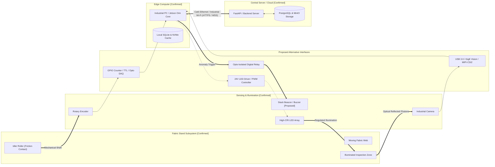

# TexEye AI — Hardware Architecture & Physical Interconnections

## 1. System Hardware Architecture Overview

TexEye AI is designed to run in real textile mill environments — which means dealing with factory floor vibrations, floating cotton dust, variable ambient lighting, and fabric moving continuously at production speeds.

The physical setup links optical and mechanical sensors on the fabric inspection stand to an edge processing computer, which then connects to our central backend server over the factory network.

---

## 2. Hardware Component & Interconnection Table

This table clearly distinguishes between **confirmed subsystems** (core components approved in our FYP proposal) and **proposed engineering alternatives** (specific models, interfaces, and pinouts that will be finalized during bench testing):

| Hardware Component | Connected To | Proposed Medium / Interface | Purpose & Function | Selection Status |
| :--- | :--- | :--- | :--- | :--- |
| **Industrial Camera** | Edge Computer | **Option 1:** USB 3.0 Vision **Option 2:** GigE Vision (Ethernet with PoE) **Option 3:** MIPI-CSI2 (Direct ribbon on Jetson) | Captures continuous video of the moving fabric across its full width at 30–60+ FPS. Streams frames into edge RAM. | **Confirmed Subsystem**; *Exact camera model and interface pending lab testing.* |
| **Camera Lens** | Industrial Camera | C-Mount or CS-Mount low-distortion fixed focal length lens (8mm, 12mm, or 16mm). | Focuses the image sharply across the fabric width without fish-eye distortion at the edges. | **Confirmed Subsystem**; *Focal length to match camera height.* |
| **Rotary Encoder** | Measurement Roller (Mechanical); Edge Computer (Electrical) | **Option 1:** Shielded cable to high-speed GPIO counter pins. **Option 2:** USB Data Acquisition (DAQ) module. **Option 3:** Dedicated microcontroller (STM32/Arduino) sending counts over serial USB. | Measures roller rotation as fabric moves. Outputs quadrature pulses (Channels A and B) to calculate fabric displacement ($\Delta L$) and speed. | **Confirmed Subsystem**; *PPR count (600, 1000, or 2048) and wiring circuit pending physical stand setup.* |
| **Measurement Roller** | Fabric Web (Friction contact); Rotary Encoder (Shaft coupling) | Precision aluminum or rubber-coated idler roller with smooth bearings, coupled to the encoder with a flexible shaft coupler. | Turns linear fabric movement into rotation. Rubber coating prevents fabric from slipping on the roller. | **Confirmed Subsystem**; *Roller diameter to be measured and calibrated upon assembly.* |
| **Lighting System** | Fabric Inspection Area (Optical); LED Driver (Electrical) | Linear high-CRI white LED bar light or diffused backlight panel mounted at a fixed angle above the fabric. | Provides bright, even, flicker-free light across the fabric width. Overcomes shadows and changes in room lighting. | **Confirmed Subsystem**; *Linear top-light bar confirmed; brightness and angle to be tested on real fabric.* |
| **Lighting Driver / Controller** | Lighting System (Power); Edge Computer (Optional strobe) | **Option 1:** Regulated constant-current 24V DC power supply with manual dimmer. **Option 2:** PWM strobe controller synchronized to camera exposure. | Provides steady current so LEDs don't flicker or dim when hot, which would ruin camera frames. | **Proposed Alternative**; *Standard 24V constant-current supply proposed for prototype.* |
| **Alert Mechanism** | Edge Computer (Control signal); Shop Floor (Visual / Sound) | **Option 1:** Industrial 3-color (Red/Yellow/Green) stack light with loud buzzer. **Option 2:** Optocoupler relay module driven by edge digital output pin. **Option 3:** Software-only alerts on operator's phone and edge monitor. | Gives workers an immediate visual and audible warning if the camera/light fails or if a major defect is spotted. | **Proposed Alternative**; *Software alerts confirmed; physical tower light is a proposed prototype add-on.* |
| **Edge Computer** | Camera, Encoder, Alert Light, Local Network | Internal PCIe / USB 3.0 / GPIO / Ethernet buses. | Runs camera capture, encoder reading, health checks, AI defect detection, tracking, coordinate math, and local database storage. | **Confirmed Subsystem**; *NVIDIA Jetson Orin or Mini-PC with dedicated GPU proposed.* |
| **Local Storage** | Edge Computer | High-speed internal NVMe M.2 Solid State Drive (SSD). | Holds local SQLite database (`texeye_local.db`), offline sync queue, and temporary defect image crops. Ensures zero-delay saves. | **Confirmed Subsystem**; *Internal NVMe SSD confirmed.* |
| **Network Uplink** | Edge Computer to Central Cloud | **Option 1:** Industrial Cat6 Gigabit Ethernet cable. **Option 2:** Industrial Dual-Band Wi-Fi (802.11ac/ax). | Sends HTTPS sync batches and WebSocket updates between edge computer and central backend. | **Proposed Alternative**; *Cat6 Ethernet preferred for factory stability; Wi-Fi as secondary option.* |
| **Central Backend Server** | Edge Units, Mobile Apps, Web Dashboards | On-premise server or cloud virtual machine running Linux and Docker. | Runs the FastAPI backend, PostgreSQL database, MinIO/S3 file storage, 4-point grading engine, and WebSocket hub. | **Confirmed Subsystem**; *Backend server architecture confirmed.* |

---

## 3. Interface Analysis & Engineering Trade-Offs

### 3.1 Camera-to-Edge Interface Options
1. **USB 3.0 Vision (Proposed Option A):**
   - *Good:* Works with standard PC USB ports without special cards; high bandwidth (up to 5 Gbps); easy to test on a lab bench.
   - *Considerations:* Cable length is limited to around 3 meters. In a factory with vibrating machines, we need screw-locking USB cables so nothing jiggles loose.
2. **GigE Vision / PoE (Proposed Option B):**
   - *Good:* Ethernet cables can run up to 100 meters, which is great if the computer is in a control room away from the loom. Power-over-Ethernet means one single cable carries power and video. Locking RJ45 connectors handle vibration well.
   - *Considerations:* Needs a dedicated Gigabit network card with jumbo frame support.
3. **MIPI-CSI2 (Proposed Option C):**
   - *Good:* Plugs straight into the Jetson GPU board with zero-copy memory access, giving the lowest latency and power draw.
   - *Considerations:* Ribbon cables are very short (under 30 cm) and camera sensor drivers can be tricky to configure.

### 3.2 Rotary Encoder Interface Options
1. **Direct GPIO Pin Counting (Proposed Option A):**
   - *Setup:* Encoder pulse wires connect through an optocoupler level-shifter (stepping 24V down to 3.3V logic) directly into hardware interrupt pins on the edge board.
   - *Good:* Simple and inexpensive.
   - *Considerations:* At high speeds (thousands of pulses per second), software interrupts can use up CPU time if not handled by dedicated hardware timer registers.
2. **Dedicated USB/Serial Counter Board (Proposed Option B):**
   - *Setup:* A small microcontroller (like an STM32) reads encoder pulses with its hardware quadrature decoder and sends the updated millimeter position over USB serial every 10 milliseconds.
   - *Good:* Completely frees the main computer from pulse counting, with zero risk of missed pulses due to OS multitasking.
   - *Considerations:* Adds one extra small microcontroller board inside the hardware box.

---

## 4. Hardware Selection Checklist (Decisions for Bench Testing)

These specific choices will be discussed with our project supervisor and finalized when purchasing components:

- [ ] **Camera Resolution vs. Field of View:** We need to choose between a 2MP and a 5MP camera to make sure we can resolve flaws as small as 0.5 mm across a 1.5-meter fabric width.
- [ ] **Camera Cable Choice:** Finalize whether to use USB 3.0 (easier for bench prototype) or GigE Vision (better for long cable runs on a factory frame).
- [ ] **Encoder Resolution (PPR):** Match the encoder pulses-per-revolution (e.g., 1000 PPR) to our roller diameter to get at least 1 mm measurement accuracy.
- [ ] **Lighting Brightness:** Test LED brightness (lux) on actual fabric samples to make sure we can use fast shutter speeds (1–2 ms) without motion blur.
- [ ] **Edge Computer Selection:** Choose between an NVIDIA Jetson Orin Nano/NX (small, low power, mounts directly on frame) or a Mini-PC with an RTX GPU (more compute headroom for running bigger models).

---

## 5. Scope Boundary Protections (What is NOT Connected)

To stay strictly within our approved FYP scope:
- **No motor or machine controls:** TexEye AI does not connect to machine motor inverters, variable speed drives, or emergency stop buttons.
- **No cutting blades:** There are no automatic knives or fabric slitters connected to the system.
- **No ink marking systems:** We record defect locations digitally on a 2D map instead of physically spraying ink or stamping chalk onto the fabric.
