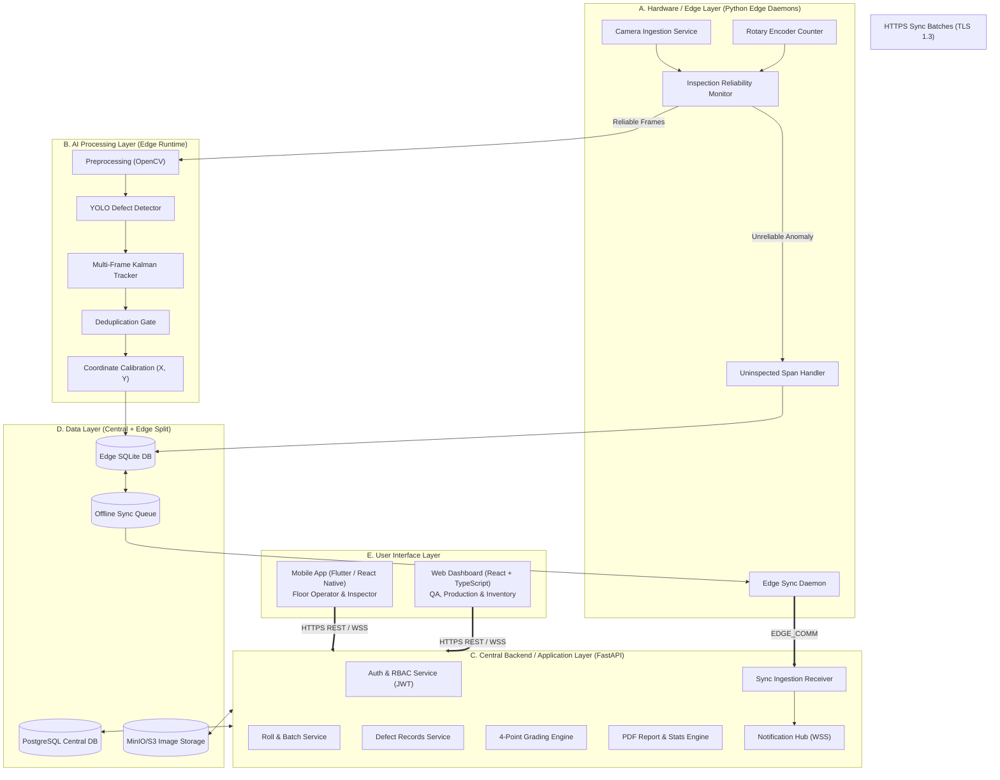

# TexEye AI — Software Architecture & Service Communication

## 1. Architectural Philosophy & Layered Organization

The software for **TexEye AI** is organized into five clean, decoupled layers. This structure lets the edge computer process high-speed camera frames and save detections locally without lag, while keeping the central backend and user interfaces clean and responsive:

1. **Layer A: Hardware / Edge Layer** (Captures video, reads encoder pulses, and monitors sensor health)
2. **Layer B: AI Processing Layer** (Image enhancement, YOLO defect detection, multi-frame tracking, and metric location math)
3. **Layer C: Backend / Application Layer** (Business logic, ASTM 4-point grading engine, sync receiver, and user authentication)
4. **Layer D: Data Layer** (Local SQLite outbox on the edge, central PostgreSQL database, and MinIO/S3 image storage)
5. **Layer E: User Interface Layer** (Mobile app for floor operators and web dashboard for quality managers)



---

## 2. Software Technology Recommendation Table

Here are the technologies we recommend across each layer. **These choices are engineering proposals based on real-world stability, performance, and hardware support, rather than rigid constraints:**

| Layer / Service | Proposed Technology | Reason & Purpose | Communication |
| :--- | :--- | :--- | :--- |
| **A. Camera Capture Service** | Python 3.10+ with OpenCV / V4L2 / GenICam SDK | Direct hardware buffer capture, ring buffer in memory, and millisecond frame timestamping. | Camera driver API &bull; Shared memory buffer |
| **A. Encoder Reading Service** | Python / C++ with `gpiod` or `pyserial` | Reads hardware interrupt pulses, counts ticks, and calculates fabric speed and distance traveled ($\Delta L$). | GPIO interrupts &bull; Serial/UART over USB |
| **A. Reliability Gate & Watchdog** | Python service using OpenCV Laplacian filters and luminance checks | Validates frame stream continuity, checks image sharpness, and verifies lighting levels before frames hit AI. | In-memory function pipeline |
| **B. Image Preprocessing** | OpenCV + NumPy | Crops region of interest (ROI), corrects lens distortion using calibration matrices, and applies CLAHE contrast enhancement. | In-memory NumPy array transfer |
| **B. Defect Detection Model** | PyTorch / ONNX Runtime / NVIDIA TensorRT (YOLOv8 or RT-DETR) | Runs deep learning inference directly on the edge GPU, outputting bounding boxes, defect labels, and confidence scores. | CUDA tensor execution |
| **B. Multi-Frame Tracking & Deduplication** | Kalman Filter + Hungarian IoU matching | Tracks defects across consecutive frames as fabric advances, merging duplicate detections into one unique defect record. | In-memory track state machine |
| **B. Coordinate Mapping Engine** | NumPy calibration module | Converts pixel bounding box centroids into lateral centimeters ($X_{cm}$) and integrates encoder pulses for longitudinal meters ($Y_m$). | Internal Python function calls |
| **C. Central Backend API** | FastAPI (Python 3.11+) with Uvicorn ASGI | Fast, asynchronous REST API. Handles user auth, roll sessions, defect verification, grading, and sync uploads. | HTTPS / TLS 1.3 &bull; JSON &bull; OpenAPI documentation |
| **C. Authentication & Roles** | PyJWT + Passlib (Argon2 / BCrypt) | Issues secure, stateless JWT tokens with role scopes (`OPERATOR`, `INSPECTOR`, `PROD_MGR`, `INV_MGR`, `ADMIN`). | HTTP `Authorization: Bearer <token>` |
| **C. 4-Point Grading Engine** | Python business logic service | Implements the ASTM D5430 standard: computes penalty points per 100 square meters and assigns final grade (A, B, C, or Reject). | Internal service method &bull; PostgreSQL query |
| **C. Notification Hub** | WebSockets (Starlette / FastAPI) + Firebase Cloud Messaging (FCM) | Pushes real-time alerts to mobile phones and streams new defect coordinates to the live defect map on the web dashboard. | WebSocket (`wss://`) &bull; FCM push |
| **D. Local Edge Database** | SQLite 3 (WAL Mode enabled) | Fast, zero-lag local transactions on the factory floor. Runs independently of network connection. | Python `sqlite3` driver |
| **D. Local Image Cache** | Local NVMe SSD storage | Ring-buffered local folder storing cropped defect images before they are uploaded to the cloud. | POSIX file I/O |
| **D. Central Database** | PostgreSQL 16 | Central relational database storing rolls, verified defects, grading history, users, and audit logs. | TCP Port 5432 via SQLAlchemy / Asyncpg |
| **D. Cloud File Storage** | MinIO (Self-hosted) or AWS S3 | Stores high-resolution defect crop pictures, inspection report templates, and generated PDF certificates. | HTTPS S3 REST API (boto3 / minio-py) |
| **E. Mobile Application** | Flutter (Dart) or React Native (TypeScript) | Cross-platform mobile app for tablets and phones. Used for QR code scanning, viewing live alerts, and reviewing defects. | HTTPS REST &bull; WebSockets &bull; JWT Auth |
| **E. Web Dashboard** | React 18+ with TypeScript, Tailwind CSS, and HTML5 Canvas | Desktop web portal for quality managers. Renders the interactive 2D defect map, manages grading, and exports PDF reports. | HTTPS REST &bull; WebSockets &bull; HTML5 Canvas |

---

## 3. Structural Distinction of Architectural Elements

To keep our system boundaries clear for university presentation:

### 3.1 Internal Software Modules (Within a Single Process)
- *Examples:* OpenCV Preprocessing Pipeline, Focus/Blur Filter, Kalman Tracker, Coordinate Calculator, 4-Point Penalty Calculator.
- *How they work:* Run inside the memory space of their parent process. They pass data using memory pointers, function arguments, and thread-safe queues.

### 3.2 Independent Services (Separate Daemons & Processes)
- *Examples:* `texeye-capture-daemon`, `texeye-inference-runtime`, `texeye-sync-agent`, FastAPI Backend, PostgreSQL Server, MinIO Server.
- *How they work:* Dedicated system services or Docker containers running on their own schedule. They communicate via Unix domain sockets, local loopback, or network sockets.

### 3.3 External Systems (Outside System Boundary)
- *Examples:* Mill ERP / Inventory systems, external SMS/Email gateways, Google FCM push servers.
- *How they work:* Systems outside TexEye AI codebase, connected purely via standard REST APIs or webhooks.

### 3.4 Hardware Components (Physical Devices)
- *Examples:* Industrial Area-Scan Camera, Rotary Encoder, Measurement Roller, LED Light Array, Stack Tower Light, Edge Computer, Shop Floor Tablets.
- *How they work:* Real electronics and sensors interfacing with software through device drivers and physical ports.

---

## 4. Client-to-Backend Communication Architecture

### 4.1 Mobile Application Communication Flow
1. **Login:** The operator logs in through `POST /api/v1/auth/login`. If valid, the backend returns a signed JWT token with role claims.
2. **QR Code Roll Linking:** When an operator scans a roll's QR code on the stand, the app sends `GET /api/v1/rolls/{roll_code_qr}`. The backend returns roll metadata which is saved in local app memory.
3. **Live Alert Ingestion:** The app connects to a WebSocket at `wss://texeye.local/ws/alerts`. If the edge triggers an uninspected section or a critical defect, the server broadcasts an immediate alert payload:
   ```json
   {
     "event": "UNINSPECTED_SECTION_WARNING",
     "session_id": "8f1a2b3c-...",
     "roll_id": "4d5e6f7a-...",
     "span": { "start_m": 14.2, "end_m": 16.5 },
     "reason": "CAMERA_DISCONNECTED",
     "timestamp": "2026-11-11T09:15:00Z"
   }
   ```
4. **Defect Correction:** If an operator reviews a detected defect image on screen and corrects its label, the app calls `PATCH /api/v1/defects/{defect_id}/verify` with the updated class name and operator ID.

### 4.2 Web Dashboard Communication Flow
1. **Interactive Fabric Defect Map:**
   - The web app fetches roll data via `GET /api/v1/rolls/{roll_id}/defect-map`.
   - The response includes roll length and width, all defect coordinates $[X_{cm}, Y_m]$, defect classes, and uninspected sections $[L_1, L_2]$.
   - The dashboard renders an interactive 2D HTML5 canvas. The length runs horizontally, the width vertically, defects appear as color-coded clickable pins, and uninspected segments show up as amber warning bars.
2. **Live Telemetry:**
   - During active inspection, the dashboard subscribes to `wss://texeye.local/ws/telemetry/{session_id}` to watch meters roll by and see new defects pop up on the canvas live.
3. **PDF Report Generation:**
   - The quality manager clicks "Generate Inspection Certificate". The browser calls `POST /api/v1/reports/roll/{roll_id}/pdf`.
   - The backend runs 4-point grading formulas, builds a PDF summary complete with defect map snapshots and stats, and downloads the PDF directly in the browser.
