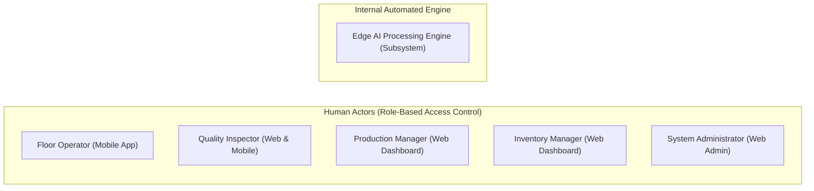

# TexEye AI — System Actors & UML Use Case Specifications

## 1. System Actors Identification & Role Matrix

To model who uses TexEye AI without redundant accounts, we define five human roles reflecting standard factory floor responsibilities, plus one automated edge subsystem:

### 1.1 Detailed Actor Descriptions

| Actor Name | Primary Job on Floor | Information Accessed | Actions & Permissions | Device Touchpoint |
| :--- | :--- | :--- | :--- | :--- |
| **Floor Operator** | Runs the fabric winding stand; sets up rolls and reacts to physical alerts. | Active roll details, live speed, inspected length, defect and uninspected warnings. | &bull; Log in / Log out. &bull; Scan roll QR code to start a session. &bull; View live meters inspected. &bull; Receive audible/vibration alerts. &bull; View thumbnail photos of detected defects. | Shop floor mobile phone / tablet |
| **Quality Inspector** | Reviews detected flaws, verifies classification, and approves certified grades. | Interactive 2D defect map, defect crop photos, model confidence, 4-point penalty totals. | &bull; Log in / Log out. &bull; Explore 2D Digital Fabric Defect Map. &bull; Review and zoom in on defect images. &bull; **Correct defect labels** (e.g., change 'Stain' to 'Oil Spot') or adjust boxes. &bull; Confirm ASTM 4-point grade. &bull; Generate signed PDF inspection reports. | Quality lab desktop PC / Tablet |
| **Production Manager** | Tracks mill throughput, loom efficiency, and defect trends. | Defect frequency charts, roll pass/fail rates, shift performance, historical quality logs. | &bull; Log in / Log out. &bull; View production summary dashboard. &bull; Filter inspection history by batch or loom. &bull; Export quality statistics. | Office workstation / PC |
| **Inventory Manager** | Manages warehouse rolls, rack allocations, and scrap isolation. | Certified roll grade (A, B, C, Reject), roll dimensions, warehouse rack locations, quarantine status. | &bull; Log in / Log out. &bull; View warehouse inventory. &bull; Assign shelf/bay locations to passed rolls. &bull; Manage quarantine tags on rejected rolls. &bull; Clear rolls for shipping. | Warehouse PC / Tablet |
| **System Administrator** | Handles system settings, accounts, edge camera/encoder calibration, and logs. | User accounts, role permissions, calibration constants (mm/pulse, cm/px), system health logs. | &bull; Log in / Log out. &bull; Create and manage user accounts. &bull; Assign RBAC roles. &bull; Adjust calibration settings and alert thresholds. &bull; Check sync queues and database backups. | Web admin panel |
| **Edge AI Subsystem** *(Automated Internal Actor)* | Edge background services handling camera capture, sensor checks, neural inference, and cloud sync. | Raw camera stream, encoder pulses, brightness metrics, local SQLite database. | &bull; Capture continuous video frames. &bull; Count encoder pulses for distance. &bull; Audit reliability gates. &bull; **Flag uninspected sections on sensor fault**. &bull; Run YOLO model and track defects. &bull; Buffer locally and auto-sync when online. | Industrial edge PC / Jetson |

---

## 2. Actor-Wise UML Use Case Breakdown

### 2.1 Floor Operator Use Cases
- `UC-OP-01`: Login / Logout
- `UC-OP-02`: Scan Roll QR Code
- `UC-OP-03`: View Active Roll Information
- `UC-OP-04`: Receive Inspection Warning Alerts (Uninspected Section / Critical Defect)
- `UC-OP-05`: Review Detected Defects on Mobile Screen

### 2.2 Quality Inspector Use Cases
- `UC-QI-01`: Login / Logout
- `UC-QI-02`: View Digital Fabric Defect Map (Interactive 2D Roll Canvas)
- `UC-QI-03`: Review Detected Defect High-Resolution Images
- `UC-QI-04`: Correct Defect Record (*<<extend>>* `UC-QI-03`: change class or adjust bounding box)
- `UC-QI-05`: View Roll Inspection Status & Uninspected Intervals
- `UC-QI-06`: Confirm / Update 4-Point Roll Grading (*<<include>>* `UC-QI-02`)
- `UC-QI-07`: Generate Digital Inspection Report (*<<include>>* `UC-QI-06`)

### 2.3 Production Manager Use Cases
- `UC-PM-01`: Login / Logout
- `UC-PM-02`: View Production Executive Dashboard
- `UC-PM-03`: View Defect Pareto Statistics & Trend Analytics
- `UC-PM-04`: View Historical Production Quality Records

### 2.4 Inventory Manager Use Cases
- `UC-IM-01`: Login / Logout
- `UC-IM-02`: View Warehouse Inventory Records
- `UC-IM-03`: Update Roll Warehouse Storage Location (Bay/Shelf)
- `UC-IM-04`: View Certified Roll Grading Status
- `UC-IM-05`: Manage Scrap & Quarantined Roll Segregation Records

### 2.5 System Administrator Use Cases
- `UC-ADMIN-01`: Login / Logout
- `UC-ADMIN-02`: Manage User Accounts (Create, Update, Deactivate)
- `UC-ADMIN-03`: Assign Roles & Scopes (RBAC Management)
- `UC-ADMIN-04`: Configure Edge Calibration Parameters & Quality Thresholds

### 2.6 Internal Automated Edge Engine Use Cases
- `UC-AUTO-01`: Capture Fabric Image Stream
- `UC-AUTO-02`: Read Rotary Encoder Displacement Pulses
- `UC-AUTO-03`: Monitor Inspection Reliability Gates (Cam, Light, Focus, Drop)
- `UC-AUTO-04`: Mark Fabric Section as Uninspected (*<<extend>>* `UC-AUTO-03` upon degradation event)
- `UC-AUTO-05`: Detect Fabric Defects (YOLO Neural Inference)
- `UC-AUTO-06`: Track Defects Across Consecutive Frames (*<<include>>* `UC-AUTO-05`)
- `UC-AUTO-07`: Estimate Metric Physical Coordinates ($X_{cm}, Y_m$) (*<<include>>* `UC-AUTO-06`)
- `UC-AUTO-08`: Store Inspection Records in Local SQLite Database
- `UC-AUTO-09`: Synchronize Records When Internet / Central Network Restores
- `UC-AUTO-10`: Trigger Floor Alarm Beacon & Dispatch Push Notifications

---

## 3. Formal Use Case Specifications Table

### Use Case 1: UC-AUTO-04 — Mark Fabric Section as Uninspected (Core Invariant)
- **Primary Actor:** Edge AI Subsystem (Automated)
- **Stakeholders & Interests:** Floor Operator (needs quick notification), Quality Inspector (must know which fabric wasn't checked), Production Manager (needs accurate quality figures).
- **Preconditions:** Active inspection session is running; fabric is moving past the camera stand.
- **Trigger:** Reliability gate detects any of the following:
  1. Camera disconnects or packets drop.
  2. Average brightness drops below $L_{min}$ or spikes above $L_{max}$.
  3. Image blur check fails ($\sigma^2_{Lap} < \theta_{blur}$).
  4. Sequence analyzer spots consecutive dropped frames.
- **Main Success Scenario:**
  1. The reliability gate catches the bad frame and pauses the AI detection model.
  2. The system reads the current encoder position ($Y_1 = Y_{\text{start}}$).
  3. The system waits until all sensor checks return to normal at ($Y_2 = Y_{\text{end}}$).
  4. The system calculates the uninspected distance $\Delta L = Y_2 - Y_1$ meters.
  5. The edge writes an `uninspected_sections` record with `session_id`, `roll_id`, `start_position_m`, `end_position_m`, and `failure_reason`.
  6. The edge trips the relay to switch the tower light to amber/red and sounds the buzzer.
  7. The edge broadcasts a warning event across WebSocket.
  8. Operator phones vibrate and display the warning.
- **Postconditions:** The stretch $[Y_1, Y_2]$ is saved permanently as **`UNINSPECTED`**. It cannot pass as Grade A without a human inspector checking it. **It is never recorded as clean or defect-free.**
- **Exceptions:** If the sensor issue lasts longer than 10 meters, the buzzer sounds continuously to encourage the operator to stop the fabric feed.

---

### Use Case 2: UC-QI-04 — Review & Correct Defect Record
- **Primary Actor:** Quality Inspector
- **Preconditions:** Inspector is logged in with valid JWT token; inspection session has defect records.
- **Trigger:** Inspector clicks a defect pin on the 2D defect map or opens the defect review list.
- **Main Success Scenario:**
  1. The web dashboard displays the defect crop image, predicted class (e.g., "Stain"), confidence score (e.g., 0.82), coordinates ($X = 45.2$ cm, $Y = 18.6$ m), and bounding box.
  2. The inspector inspects the image and identifies it as an "Oil Spot" from machine bearings.
  3. The inspector picks "Oil Spot" from the dropdown and adjusts the bounding box if needed.
  4. The inspector clicks "Confirm Correction".
  5. The app sends `PATCH /api/v1/defects/{id}/verify` with `corrected_class = "OIL_SPOT"`, `is_verified = true`, and the inspector's ID.
  6. The backend updates the record, logs an audit entry, and recalculates 4-point penalty scores.
  7. The updated label updates instantly on the 2D defect map.
- **Postconditions:** Defect record is verified; roll penalty points update; audit history stores both original AI prediction and human correction for model retraining.

---

### Use Case 3: UC-AUTO-09 — Synchronize Records When Internet Returns
- **Primary Actor:** Edge Sync Daemon (Automated)
- **Preconditions:** Edge computer has queued records in `offline_sync_queue` from an internet outage; local SQLite has unsynced rows (`sync_status = 'PENDING'`).
- **Trigger:** Background heartbeat check `HTTPS GET /api/v1/health` receives a 200 OK from the central backend.
- **Main Success Scenario:**
  1. The sync worker acquires a sync lock so multiple syncs don't clash.
  2. The worker selects up to 50 pending records from `offline_sync_queue` sorted by timestamp.
  3. The worker loads the corresponding defect crop images from local NVMe storage.
  4. The worker bundles the payload with gzip compression and checksums.
  5. The worker posts the batch to `HTTPS POST /api/v1/sync/batch`.
  6. The backend checks payload integrity and performs an atomic upsert into PostgreSQL using UUIDv4 idempotency keys.
  7. The backend saves images to MinIO/S3 and returns 200 OK with confirmed IDs.
  8. The edge updates queue rows to `sync_status = 'SYNCED'`.
  9. The edge cleans up synced images from the local drive according to FIFO retention limits.
- **Postconditions:** Central database matches edge records 100%; local disk space is freed up.
- **Exceptions:** If the connection drops during upload, the batch rolls back on the edge and retries with exponential backoff.
