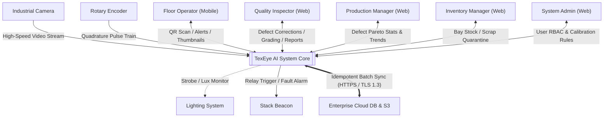
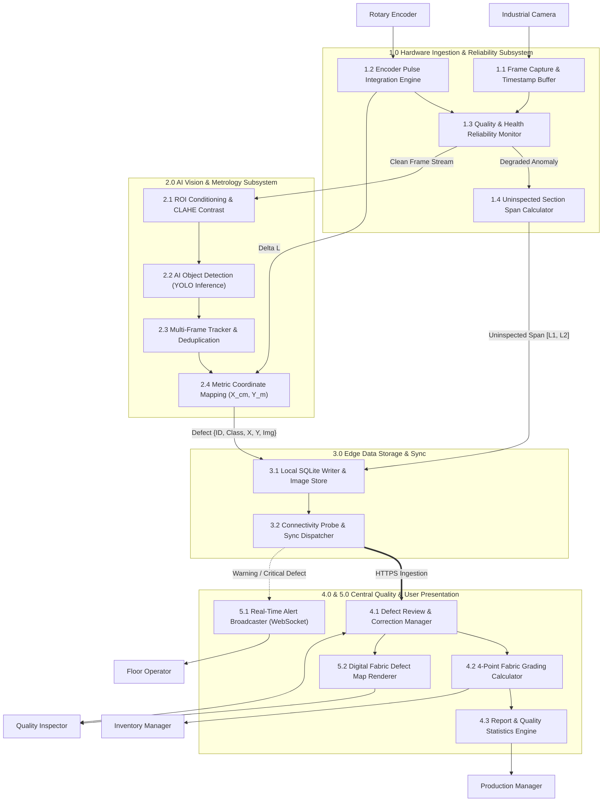

# TexEye AI — Data Flow Diagrams (Context, Level 0 & Level 1)

## 1. Context Diagram (System Level 0 Context)

The Context Diagram outlines the external boundaries of TexEye AI, showing how factory operators, hardware sensors, and cloud infrastructure communicate with our core system.



---

## 2. Level 0 Data Flow Diagram (DFD L0)

The Level 0 Data Flow Diagram breaks TexEye AI into five primary processes, showing the data flowing between processes and data stores:

```mermaid
flowchart TB
    P1["1.0 Ingest & Validate Hardware Signals"]
    P2["2.0 Process AI Detection, Tracking & Metrology"]
    P3["3.0 Manage Edge Persistence & Sync Queue"]
    P4["4.0 Manage Central Quality, Grading & Reports"]
    P5["5.0 Serve User Applications & Dispatch Alerts"]

    D1[("D1: Local SQLite DB")]
    D2[("D2: Offline Sync Queue")]
    D3[("D3: Central PostgreSQL DB")]
    D4[("D4: Cloud Object Storage")]

    CAM["Industrial Camera"] -->|Raw Frames| P1
    ENC["Rotary Encoder"] -->|Encoder Pulses| P1
    P1 -->|Reliable Frames + Delta L| P2
    P1 -->|Uninspected Span [L1, L2]| P3
    P2 -->|Unique Defect Records (X, Y)| P3

    P3 <--> D1
    P3 <--> D2
    P3 == "HTTPS Batch Sync" ==> P4
    P3 == "Upload Defect Crops" ==> D4

    P4 <--> D3
    P4 --> P5

    P5 <--> OP["Floor Operator"]
    P5 <--> QI["Quality Inspector"]
    P5 <--> PM["Production Manager"]
    P5 <--> IM["Inventory Manager"]
    P5 <--> ADMIN["System Admin"]
```

### Data Stores Description:
- **D1 (Local SQLite DB):** Local edge database storing active sessions, real-time defect entries, and uninspected intervals.
- **D2 (Offline Sync Queue):** Local outbox table tracking ordered, idempotent transactions waiting to upload to the cloud.
- **D3 (Central PostgreSQL DB):** Central database holding final roll data, verified defect logs, 4-point grades, user accounts, and audit records.
- **D4 (Cloud Object Storage - MinIO/S3):** Cloud file store archiving compressed defect crop images and generated PDF inspection certificates.

---

## 3. Level 1 Data Flow Diagram (DFD L1)

The Level 1 Data Flow Diagram zooms into the sub-processes within each module:



### Detailed Sub-Process Logic:
- **1.3 Quality & Health Reliability Monitor:** Compares frame timestamps against fabric speed ($\Delta t_{frame} \approx \Delta L / v_{fabric}$), checks Laplacian variance for blur, and verifies average brightness.
- **1.4 Uninspected Section Span Calculator:** Saves starting encoder count when a sensor issue occurs; monitors until resolved; calculates meters of fabric missed; logs failure reason (e.g., `DROPPED_FRAMES` or `CAMERA_DISCONNECTED`).
- **2.3 Multi-Frame Tracker & Deduplication:** Matches defect bounding boxes across consecutive frames using IoU tracking. Makes sure a single physical flaw isn't counted multiple times as it passes through the field of view.
- **2.4 Metric Coordinate Mapping:** Converts pixel locations $(u, v)$ to width $X_{cm}$ using camera calibration and converts encoder pulses into length $Y_m$.
- **4.2 4-Point Fabric Grading Calculator:** Standard ASTM D5430 penalty scale:
  - Defect length up to 3 inches: **1 point**
  - Defect length over 3 to 6 inches: **2 points**
  - Defect length over 6 to 9 inches: **3 points**
  - Defect length over 9 inches / holes over 1 inch: **4 points**
  - Formula:
    $$\text{Points per } 100\text{ m}^2 = \frac{\text{Total Penalty Points} \times 10,000}{\text{Total Length (m)} \times \text{Fabric Width (cm)}} \times 100$$
