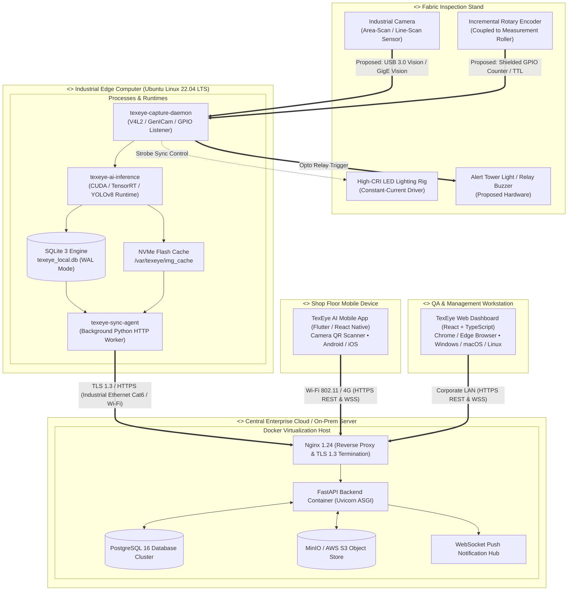

# TexEye AI — UML Component & Deployment Architecture

## 1. UML Component Architecture

The Component Diagram shows our software building blocks, their exposed interfaces, and the connections between edge, backend, and user applications.

```mermaid
flowchart TB
    subgraph EDGE_COMP ["texeye-edge-core Subsystem"]
        COMP_CAM["[Component] CameraIngestion"]
        COMP_ENC["[Component] EncoderTelemetry"]
        COMP_REL["[Component] ReliabilityMonitor"]
        COMP_AI["[Component] DefectDetector"]
        COMP_TRACK["[Component] MultiFrameTracker"]
        COMP_MAP["[Component] CoordinateMapper"]
        COMP_STORE["[Component] LocalPersistenceManager"]
        COMP_SYNC["[Component] EdgeSyncClient"]
    end

    subgraph BACKEND_COMP ["texeye-backend-api Subsystem"]
        COMP_SYNC_RCV["[Component] SyncReceiverService"]
        COMP_AUTH["[Component] Auth & RBAC Service"]
        COMP_ROLL["[Component] RollManagerService"]
        COMP_DEFECT["[Component] DefectManagerService"]
        COMP_GRADE["[Component] GradingEngine (4-Point)"]
        COMP_REPORT["[Component] ReportGenerator"]
        COMP_NOTIF["[Component] NotificationHub (WSS)"]
    end

    subgraph CLIENT_COMP ["user-applications Subsystem"]
        COMP_MOB["[Component] TexEyeMobileClient"]
        COMP_WEB["[Component] TexEyeWebDashboard"]
    end

    COMP_CAM --> COMP_REL
    COMP_ENC --> COMP_REL
    COMP_REL -->|ICameraStream| COMP_AI
    COMP_AI --> COMP_TRACK --> COMP_MAP
    COMP_ENC -->|IEncoderPosition| COMP_MAP
    COMP_MAP --> COMP_STORE
    COMP_REL -->|IUninspectedEvent| COMP_STORE
    COMP_STORE --> COMP_SYNC

    COMP_SYNC == "ISyncIngest (HTTPS REST)" ==> COMP_SYNC_RCV
    COMP_SYNC_RCV --> COMP_ROLL
    COMP_SYNC_RCV --> COMP_DEFECT
    COMP_DEFECT --> COMP_GRADE --> COMP_REPORT

    COMP_MOB == "IAuthService / IDefectService" ==> COMP_AUTH
    COMP_WEB == "IReportService / IRollService" ==> COMP_ROLL
    COMP_NOTIF -.->|IPushAlerts (WSS)| COMP_MOB
    COMP_NOTIF -.->|ITelemetry (WSS)| COMP_WEB
```

### 1.1 Interface Contracts
- `ICameraStream`: Feeds raw video frames along with incrementing frame IDs and millisecond timestamps.
- `IEncoderPosition`: Delivers total pulse count, current line speed (m/min), and incremental distance $\Delta L$.
- `IReliabilityStatus`: Provides a real-time boolean health status; triggers an event whenever camera feed, lighting lux, or frame rates fail.
- `IDefectInference`: Takes preprocessed image tensors; returns bounding boxes, defect labels, and confidence metrics.
- `ISyncDispatch`: Bundles pending queue entries into idempotent multipart REST batches sent to the cloud.

---

## 2. UML Deployment Architecture (Physical Execution Topology)

The Deployment Diagram details physical devices, runtime environments, Docker containers, and network connections.



### 2.1 Deployment Node Specifications
1. **Fabric Inspection Stand:** Physical frame holding the fabric roll, contact roller, overhead camera, lighting bar, and alert beacon.
2. **Edge Computer Node:** Industrial embedded GPU unit (NVIDIA Jetson Orin Nano/NX or Industrial Mini-PC with dedicated GPU) running Ubuntu Linux 22.04 LTS. Runs video capture, YOLO inference, local SQLite, and sync workers.
3. **Central Server Node:** On-prem server or cloud VM running Docker. Houses Nginx reverse proxy, FastAPI backend containers, PostgreSQL 16 database, and MinIO/S3 storage.
4. **Mobile Device Node:** Android or iOS devices used by floor operators to scan roll QR codes, review alerts, and inspect defect thumbnails.
5. **Quality Workstation Node:** Desktop PCs running standard web browsers connected over local network to display the 2D defect map and certify roll grades.
