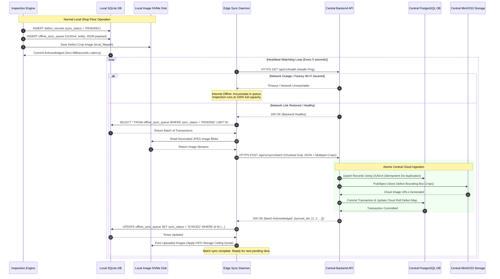

# TexEye AI — UML Sequence Diagrams

## 1. Sequence Diagram 1: Real-Time Fabric Inspection & Reliability Gating

This diagram walks through what happens during real-time fabric movement, highlighting the two paths: normal AI defect detection vs. isolating uninspected fabric when a sensor issue arises.

```mermaid
sequenceDiagram
    autonumber
    actor OP as Floor Operator
    participant STAND as Fabric Roller
    participant ENC as Rotary Encoder
    participant CAM as Industrial Camera
    participant MON as Edge Reliability Gate
    participant AI as AI Vision & Tracking Engine
    participant DB as Local SQLite Storage
    participant CLOUD as Central Backend API
    actor QI as Quality Inspector (Web)

    OP->>DB: Initiate Inspection Session (Scan Roll QR)
    DB-->>OP: Session Confirmed (Roll ID, Fabric Spec)
    
    STAND->>ENC: Fabric Moves (Linear Motion)
    ENC->>MON: Stream Channel A/B Pulses (Distance Increment ΔL)
    STAND->>CAM: Fabric Reflects Uniform Light
    CAM->>MON: Deliver High-Speed Frame Stream (Timestamped)

    Note over MON: Reliability Validation (Cam, Light, Blur, Drop-frame)

    alt Condition A: Reliability Check Passed (Optimal Conditions)
        MON->>AI: Forward Clean Frame + Rotary Pulse Count
        AI->>AI: Image Preprocessing (CLAHE Contrast + ROI)
        AI->>AI: Deep Learning Defect Detection (YOLO Inference)
        AI->>AI: Multi-Frame Tracking (Kalman Filter + IoU Association)
        AI->>AI: Spatial-Temporal Deduplication (Consolidate repeat detections)
        AI->>AI: Metric Coordinate Calculation (X_cm from calib, Y_m from encoder)
        AI->>DB: INSERT defect_records (Track_ID, Class, X, Y, ImgBlob)
        DB-->>AI: Transaction Committed (Local Zero-Latency)
        
        opt Defect Severity Exceeds Alert Threshold
            AI->>OP: Push Instant Vibration & Audio Alert to Mobile
            AI->>CLOUD: Stream Live Coordinate via WebSocket (If Online)
            CLOUD->>QI: Render Color-Coded Defect Pin on Live Map Canvas
        end

    else Condition B: Reliability Check Failed (e.g. Frame Drop / Cam Disconnect / Light Failure)
        MON->>MON: Calculate Degraded Interval [L_start = Y, L_end = Y + ΔL]
        MON->>DB: INSERT uninspected_sections (Session, Roll, Start, End, Reason)
        Note over DB: CRITICAL INVARIANT:<br/>Marked as UNINSPECTED &bull; NEVER defect-free!
        MON->>OP: Trip Physical Tower Light Relay & Fire Mobile Warning Alarm
        MON->>CLOUD: Broadcast UNINSPECTED_SECTION_WARNING Event
        CLOUD->>QI: Draw Yellow / Amber Hashed Warning Band on Defect Map
    end

    opt Post-Inspection Defect Audit & Verification
        QI->>CLOUD: Open Defect Crop & Verify Label
        QI->>CLOUD: Submit Correction (e.g., Change Predicted 'Stain' to 'Oil Spot')
        CLOUD->>DB: Update verified_class & Re-calculate 4-Point Grade
    end
```

---

## 2. Sequence Diagram 2: Offline Data Synchronization Flow

This diagram tracks how edge data accumulates locally during a network drop and how the background sync worker uploads it safely once the network is restored.


