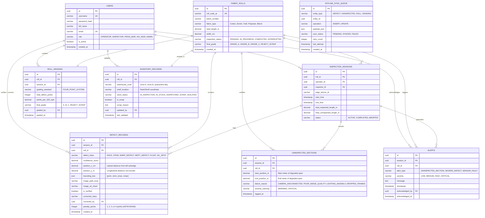

# TexEye AI — Entity Relationship Diagram (ERD) & Data Dictionary

## 1. Entity Relationship Model

The TexEye AI data model is built for full relational consistency on central PostgreSQL while remaining directly usable inside lightweight SQLite on the edge computer.

---

## 2. Relational Data Dictionary

### 2.1 Table: `fabric_rolls`
Stores master roll information, physical dimensions, and inspection state.

| Column Name | Data Type | Constraints | Description |
| :--- | :--- | :--- | :--- |
| `id` | UUID | PRIMARY KEY, NOT NULL | Unique roll ID. |
| `roll_code_qr` | VARCHAR(64) | UNIQUE, NOT NULL | Unique string encoded in the roll's QR code. |
| `batch_number` | VARCHAR(50) | NOT NULL | Mill manufacturing batch identifier. |
| `fabric_type` | VARCHAR(50) | NOT NULL | Weave category (e.g., "100% Cotton Plain Weave", "Denim 12oz"). |
| `total_length_m` | DECIMAL(10,2)| NOT NULL | Total roll length in meters. |
| `width_cm` | DECIMAL(10,2)| NOT NULL | Usable fabric width in centimeters. |
| `inspection_status` | VARCHAR(30) | NOT NULL, DEFAULT 'PENDING' | Status: `PENDING`, `IN_PROGRESS`, `COMPLETED`, `INTERRUPTED`. |
| `final_grade` | VARCHAR(20) | NULL | Final grade: `GRADE_A`, `GRADE_B`, `GRADE_C`, `REJECT_SCRAP`. |
| `created_at` | TIMESTAMP | NOT NULL, DEFAULT NOW() | Record creation date and time. |

---

### 2.2 Table: `uninspected_sections`
Enforces our core rule: explicitly tracking every fabric interval where inspection was interrupted or compromised.

| Column Name | Data Type | Constraints | Description |
| :--- | :--- | :--- | :--- |
| `id` | UUID | PRIMARY KEY, NOT NULL | Unique section ID. |
| `session_id` | UUID | FOREIGN KEY &rarr; `inspection_sessions.id` | Associated inspection session. |
| `roll_id` | UUID | FOREIGN KEY &rarr; `fabric_rolls.id` | Target fabric roll. |
| `start_position_m` | DECIMAL(10,2)| NOT NULL | Meter where sensor issue began. |
| `end_position_m` | DECIMAL(10,2)| NOT NULL | Meter where sensors recovered. |
| `failure_reason` | VARCHAR(50) | NOT NULL | Reason: `CAMERA_DISCONNECTED`, `POOR_IMAGE_QUALITY`, `LIGHTING_ANOMALY`, `DROPPED_FRAMES`. |
| `severity_warning` | VARCHAR(20) | NOT NULL | `WARNING` (&lt; 1 meter) or `CRITICAL` (&ge; 1 meter). |
| `logged_at` | TIMESTAMP | NOT NULL, DEFAULT NOW() | Timestamp when incident was logged. |

---

### 2.3 Table: `defect_records`
Stores unique detected defects, calculated physical positions, and human audit verification.

| Column Name | Data Type | Constraints | Description |
| :--- | :--- | :--- | :--- |
| `id` | UUID | PRIMARY KEY, NOT NULL | Unique defect ID. |
| `session_id` | UUID | FOREIGN KEY &rarr; `inspection_sessions.id` | Associated inspection session. |
| `roll_id` | UUID | FOREIGN KEY &rarr; `fabric_rolls.id` | Fabric roll containing defect. |
| `defect_class` | VARCHAR(40) | NOT NULL | Predicted class: `HOLE`, `STAIN`, `WARP_DEFECT`, `WEFT_DEFECT`, `FLOAT`, `OIL_SPOT`. |
| `confidence_score`| DECIMAL(5,4) | NOT NULL | Model confidence score between 0.0000 and 1.0000. |
| `position_x_cm` | DECIMAL(8,2) | NOT NULL | Distance from left edge in centimeters. |
| `position_y_m` | DECIMAL(10,2)| NOT NULL | Distance from start of roll in meters (via encoder). |
| `bounding_box` | JSON | NOT NULL | Normalized bounding box coordinates `[ymin, xmin, ymax, xmax]`. |
| `image_path_local`| VARCHAR(255)| NULL | File path on local edge NVMe drive. |
| `image_url_cloud` | VARCHAR(255)| NULL | S3 object URL after cloud sync. |
| `is_verified` | BOOLEAN | NOT NULL, DEFAULT FALSE | Whether a Quality Inspector has audited this defect. |
| `corrected_class` | VARCHAR(40) | NULL | Verified class label if inspector updated it. |
| `corrected_by` | UUID | FOREIGN KEY &rarr; `users.id`, NULL | Inspector who confirmed or changed the defect. |
| `penalty_points` | INTEGER | NOT NULL | ASTM 4-point penalty value: 1, 2, 3, or 4 points. |
| `created_at` | TIMESTAMP | NOT NULL, DEFAULT NOW() | Detection timestamp. |

---

### 2.4 Table: `offline_sync_queue`
Guarantees reliable transactional synchronization from edge to cloud.

| Column Name | Data Type | Constraints | Description |
| :--- | :--- | :--- | :--- |
| `id` | UUID | PRIMARY KEY, NOT NULL | Unique queue transaction key. |
| `entity_type` | VARCHAR(30) | NOT NULL | Entity: `DEFECT`, `UNINSPECTED`, `ROLL`, `GRADING`. |
| `entity_id` | UUID | NOT NULL | Target entity primary key. |
| `operation` | VARCHAR(10) | NOT NULL | Action: `INSERT` or `UPDATE`. |
| `payload_json` | JSON | NOT NULL | JSON payload sent to backend API. |
| `sync_status` | VARCHAR(20) | NOT NULL, DEFAULT 'PENDING' | Status: `PENDING`, `SYNCED`, `FAILED`. |
| `retry_count` | INTEGER | NOT NULL, DEFAULT 0 | Number of upload retries attempted. |
| `last_attempt` | TIMESTAMP | NULL | Timestamp of most recent attempt. |
| `created_at` | TIMESTAMP | NOT NULL, DEFAULT NOW() | When record was added to queue. |
