# TexEye AI — Member Responsibilities & Project Division

## 1. Project Division Overview

The development of **TexEye AI** is cleanly divided between our two project members to make sure both of us have clear technical ownership for university evaluation and viva defense:

```mermaid
flowchart TD
    subgraph AFNAN ["Muhammad Afnan Khan &bull; FA23-BAI-028<br/>Application Architecture, Defect Mapping &amp; Cloud Integration Lead"]
        direction TB
        A1["Mobile Application (Flutter / React Native)"]
        A2["QR Code Scanner &amp; Roll Metadata Binding"]
        A3["Defect Review &amp; On-Screen Correction Interfaces"]
        A4["Web Dashboard (React + TypeScript + Tailwind)"]
        A5["Interactive 2D Digital Fabric Defect Map"]
        A6["Roll Management &amp; Batch Lifecycle Tracking"]
        A7["4-Point ASTM Roll Grading &amp; Inventory Engine"]
        A8["Automated Digital Inspection Report (PDF) Generation"]
        A9["Application-Side Local Data Synchronization &amp; State Management"]
    end

    subgraph BILAL ["Muhammad Bilal Butt &bull; FA23-BAI-042<br/>AI Vision, Deep Learning, Hardware Integration &amp; Edge Sensing Lead"]
        direction TB
        B1["Fabric Defect Dataset Collection, Annotation &amp; Augmentation"]
        B2["Deep Learning Model Architecture, Training &amp; Evaluation (YOLO)"]
        B3["High-Throughput Real-Time Edge Defect Inference Engine"]
        B4["Multi-Frame Defect Tracking (Kalman Filter + IoU Association)"]
        B5["Spatial-Temporal Duplicate Reduction Gate"]
        B6["Rotary Encoder Hardware Integration &amp; Pulse Processing"]
        B7["Industrial Camera Driver Integration &amp; Memory Ring Buffering"]
        B8["Illumination Uniformity, Blur &amp; Optical Quality Monitoring"]
        B9["Camera Disconnection &amp; Dropped-Frame Watchdogs"]
        B10["Inspection Reliability Gate &amp; Uninspected Section Isolation"]
    end
```

---

## 2. Detailed Member Task Allocations

### 2.1 Muhammad Afnan Khan — FA23 BAI 028
**Role:** Application Architecture, Frontend Systems & Cloud Integration Lead

1. **Cross-Platform Mobile Application:**
   - Designed and built the mobile app using Flutter / React Native.
   - Built the camera QR scanner for scanning fabric roll codes on the mill floor.
   - Set up real-time vibration, sound, and visual alerts for uninspected sections or severe defects.
   - Created the mobile review screen where operators can inspect defect photos and details.

2. **Web Dashboard & Defect Map:**
   - Built the responsive desktop web dashboard using React, TypeScript, and Tailwind CSS.
   - Built the interactive 2D **Digital Fabric Defect Map** canvas: displays full roll length, plots defects with color-coded pins, and renders uninspected sections in amber warning bands.
   - Added interactive zoom, pan, and defect filtering (by class, severity, and meter range).

3. **Defect Audit & Verification:**
   - Created the on-screen review tool allowing Quality Inspectors to reclassify defects (e.g., changing 'Stain' to 'Oil Spot') or adjust bounding boxes.
   - Built the audit trail logging who modified what and when.

4. **Roll Lifecycle, Inventory & 4-Point Grading:**
   - Implemented roll lifecycle and batch management APIs.
   - Built the ASTM D5430 **4-Point Fabric Inspection Grading Engine**: calculates penalty points per 100 square meters and assigns the final grade (`GRADE_A`, `GRADE_B`, `GRADE_C`, `REJECT_SCRAP`).
   - Built warehouse inventory tools to assign shelf/bay locations and manage quarantine for scrap rolls.

5. **Reporting & Client Sync:**
   - Built the automated PDF inspection certificate generator complete with defect map snapshots and defect statistics.
   - Implemented app-side offline data caching for reliable operation during factory Wi-Fi drops.

---

### 2.2 Muhammad Bilal Butt — FA23 BAI 042
**Role:** AI Vision, Deep Learning, Hardware Integration & Edge Sensing Lead

1. **Dataset Engineering & Deep Learning Model:**
   - Collected, annotated, and augmented fabric defect images covering standard flaws: *Hole, Stain, Warp Defect, Weft Defect, Float, and Oil Spot*.
   - Trained, tuned, and evaluated YOLO object detection models, tracking $mAP_{50}$ and $mAP_{50-95}$ performance.
   - Optimized models for edge deployment using ONNX Runtime and TensorRT FP16 quantization.

2. **Real-Time Edge Inference Pipeline:**
   - Built the image conditioning pipeline with OpenCV (CLAHE contrast normalization, ROI extraction, and lens undistortion).
   - Tuned real-time inference on the edge GPU to achieve 30–60+ FPS matching inspection line speed.

3. **Multi-Frame Tracking & Deduplication:**
   - Implemented the Multi-Frame Defect Tracker using Kalman filtering and Hungarian IoU association across consecutive frames.
   - Built the deduplication logic that merges multi-frame views of a passing defect into one clean, unique record with highest confidence.

4. **Sensor Hardware Integration:**
   - Integrated industrial camera drivers (USB 3.0 / GigE Vision / V4L2) with zero-copy shared memory buffering.
   - Integrated the incremental rotary encoder via GPIO interrupts to calculate fabric displacement ($\Delta L$) and line speed.
   - Calibrated camera-to-fabric geometry to convert optical pixel coordinates $(u, v)$ to physical centimeters ($X_{cm}$) and meters ($Y_m$).

5. **Inspection Reliability Gate & Uninspected Section Isolation:**
   - Built camera connection watchdogs to catch frame drops or cable disconnects immediately.
   - Implemented brightness and uniformity monitors using grayscale histograms.
   - Implemented image sharpness checks using Laplacian variance ($\sigma^2_{Lap}$) to detect blur, dust, or lint on the lens.
   - **Enforced the Core Rule:** Automated mathematical calculation of uninspected spans $[L_{start}, L_{end}]$, ensuring compromised sections are **never** treated as defect-free.
   - Wired relay triggers for the physical stack light beacon and buzzer.

---

## 3. Joint & Shared Responsibilities

Both members collaborate closely on:
- API design (REST endpoints and WebSocket payloads).
- Physical testing and calibration on the laboratory inspection stand.
- Database schema design for PostgreSQL and SQLite.
- Supervisor progress presentations, viva preparation, and final project documentation.
